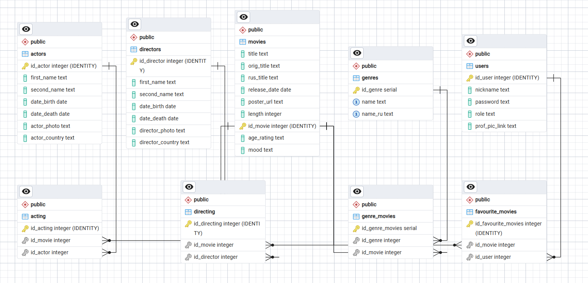

Система подбора фильмов
Данная система позволяет подбирать фильмы, а также производить операции с режиссёрами, актёрами и фильмами в режиме адмирнистратора\
Структура проекта\
mobile website/\
├── .gitignore\
├── README.md\
├── db2.sql(Резервная копия БД)\
├── docker-compose.yml(Docker-compose файл)\
├── film-finder-backend/Бекэнд\                  
│   ├── .dockerignore\
│   ├── .env(Секретные данные)\
│   ├── .gitignore\
│   ├── Dockerfile\
│   ├── requirements.txt(список библиотек для установки)\
│   └── app/(Основной каталог бекенда)\
│       ├── __init__.py\
│       ├── auth.py(Отвечает за хеширование паролей, создание и декодирование JWT токенов)\
│       ├── database.py(Отвечает за создание сессии с БД)\
│       ├── dependencies.py(Отвечает за проверку прав доступа и авторизации на уровне эндпоинтов)\
│       ├── main.py(Точка входа бекенда)\
│       ├── models.py(Описание структуры БД на языке Python)\
│       ├── schemas.py(Отвечает за валидацию входных данных)\
│       └── routers/(Эндпоинты)\
│           ├── __init__.py\
│           ├── admin.py Эндпоинты админа(Операции с фильмами, режиссёрами и т.д)\
│           ├── auth.py Эндпоинт  авторизации, регистрации, получения данных пользователя\
│           ├── favourites.py(Эндпоинт для работы со списком любимых фильмов для статистики)\
│           ├── movies.py(Эндпоинты для работы с данными фильма)\
│           ├── search.py(Эндпоинты поиска актёров, режиссёров, фильма)\
│           └── stats.py(Эндпоинт статистики)\
│
└── film-finder-frontend/(Папка Фронтенда)\
    ├── .dockerignore\
    ├── .gitignore\
    ├── Dockerfile\
    ├── eslint.config.js\
    ├── index.html\
    ├── package.json\
    ├── package-lock.json\
    ├── tsconfig.json\
    ├── tsconfig.app.json\
    ├── tsconfig.node.json\
    ├── vite.config.ts\
    ├── public/\
    │   ├── favicon.svg\
    │   └── icons.svg\
    └── src/\
        ├── App.css\
        ├── App.tsx(отвечает за навигацию)\
        ├── index.css(Подключает Tailwind)\
        ├── main.tsx(Точка входа в приложение)\
        ├── api/\
        │   └── client.ts(Отвечает за отправку запроов с фронтенда на бекенда)\
        ├── assets/\
        │   ├── hero.png\
        │   ├── react.svg\
        │   └── vite.svg\
        ├── components/\
        │   ├── Navbar.tsx(Навигационная панель)\
        │   └── ProtectedRoute.tsx(Отвечает за проверку авторизации и прав доступа)()\
        ├── hooks/\
        │   └── useUser.ts(хуки для проверки данных пользователя на фронтенде)\
        └── pages/(Страницы)\
            ├── AdminGenres.tsx(Окно редактирования жанров)\
            ├── AdminMovieNew.tsx(Окно добавления и изменения фильмов)\
            ├── AdminPersonNew.tsx(Окно добавления и изменения человека)\
            ├── AdminUserEdit.tsx(Окно редактирования пользователей)\
            ├── Home.tsx(Окно подбора)\
            ├── Login.tsx(окно логина)\
            ├── MovieDetail.tsx(Окно фильма)\
            ├── PersonDetail.tsx(Окно человека)\
            ├── Profile.tsx(Окно профиля)\
            ├── Register.tsx(Окно регистрации)\
            ├── Search.tsx(Окно поиска)\
            └── Stats.tsx(Окно статистики)\
Структура БД:\

Инструкция по запуску:
docker compose --build -d